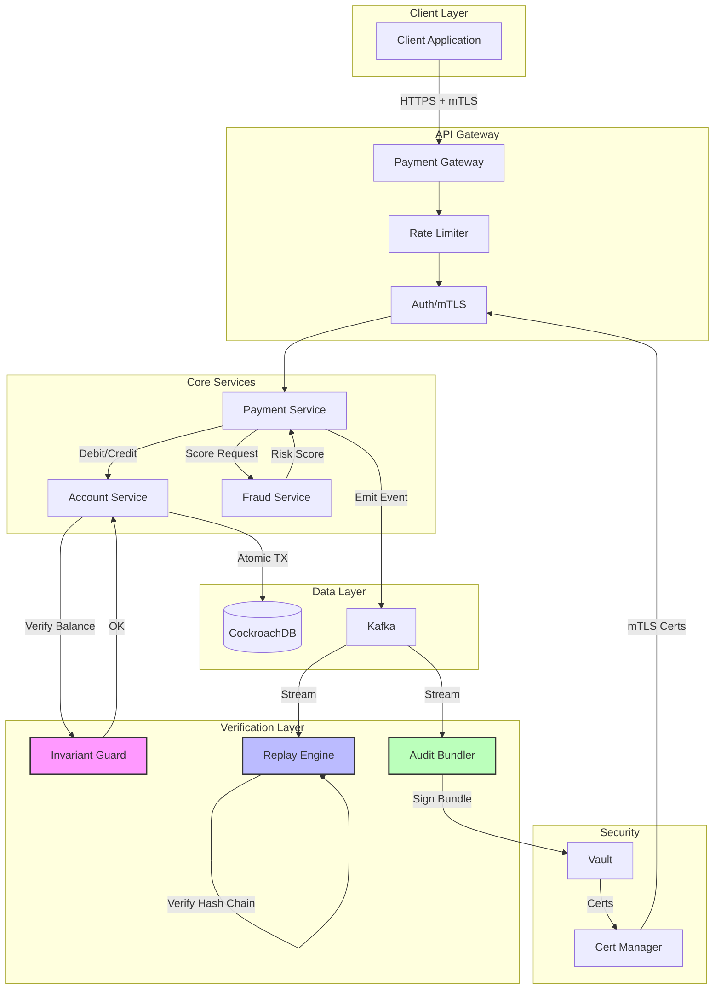
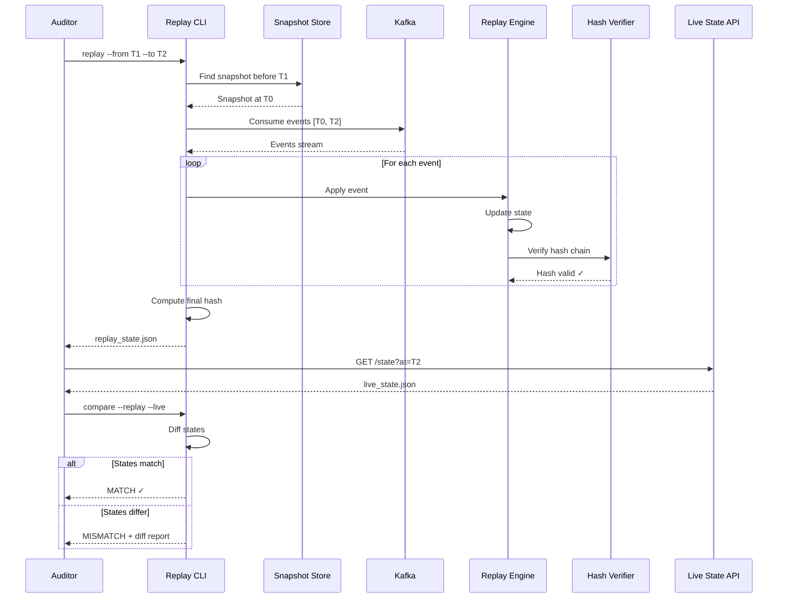
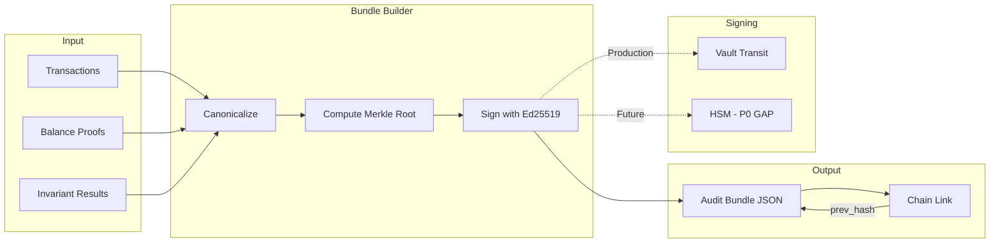
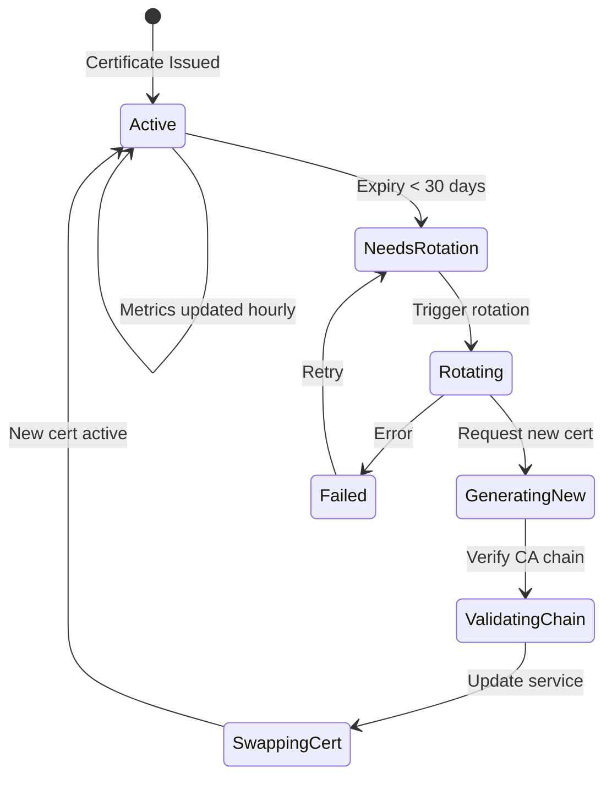
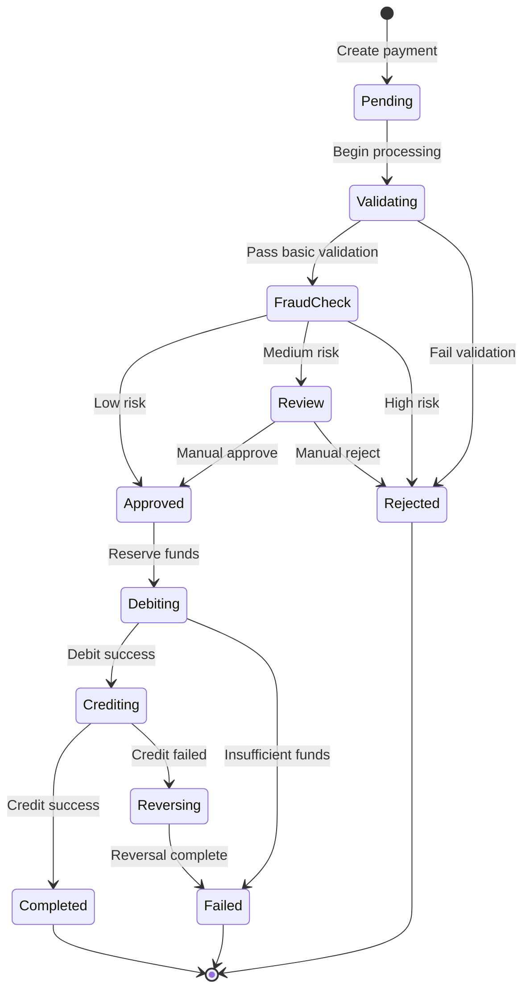
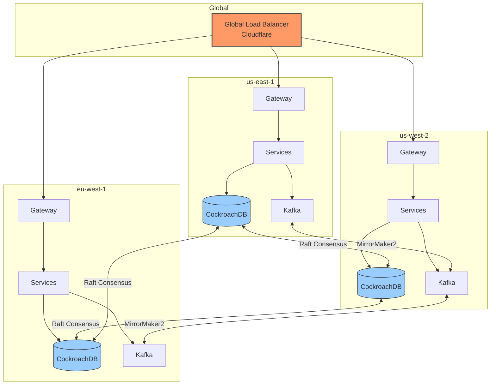

# Mermaid Diagrams

**Document:** Nexus RTP Platform Architecture Diagrams  
**Format:** Mermaid (render with GitHub, VS Code extension, or mermaid.live)

---

## 1. End-to-End Data Flow

This diagram shows the complete flow of a payment transaction through the system.



---

## 2. Deterministic Replay and Verification Flow

This diagram shows how the replay engine reconstructs and verifies historical state.



---

## 3. Audit Bundle Creation Flow



---

## 4. Security and Certificate Rotation



---

## 5. Transaction State Machine



---

## 6. Multi-Region Architecture (Target State)



**Note:** Multi-region is a P0 gap. See [p0_gaps.md](../p0_gaps.md).

---

## How to Render

### GitHub
Mermaid diagrams render automatically in GitHub markdown files.

### VS Code
Install the "Markdown Preview Mermaid Support" extension.

### Online
Paste code blocks at [mermaid.live](https://mermaid.live/).

### Command Line
```bash
npm install -g @mermaid-js/mermaid-cli
mmdc -i diagrams.md -o diagrams.pdf
```

---

*Diagrams source: docs/appendix/mermaid_diagrams.md*
